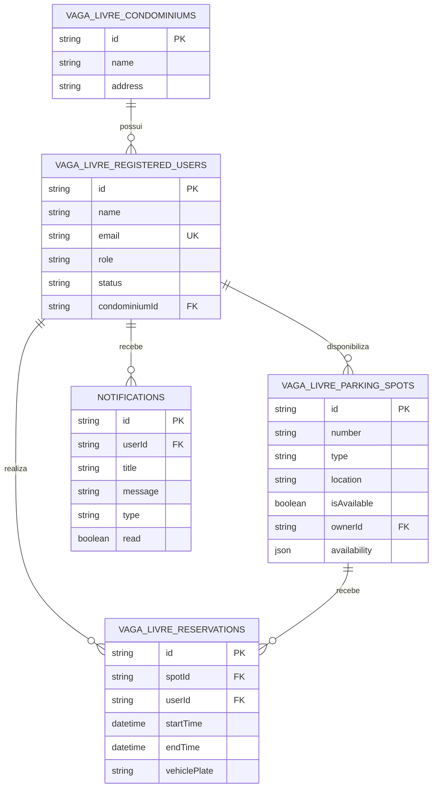
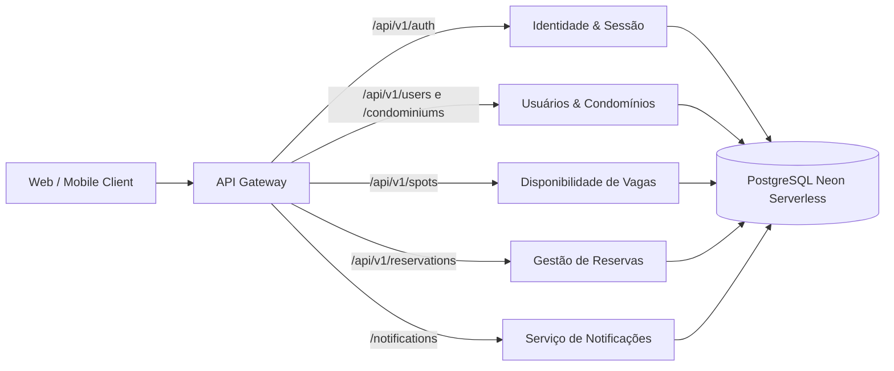
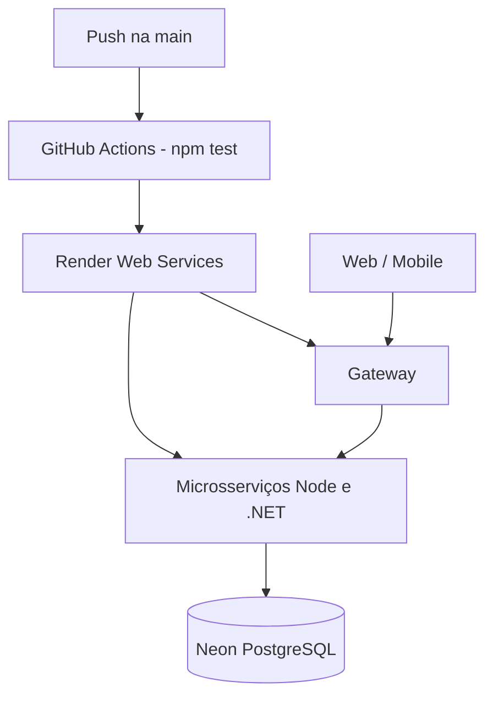

# ⚙️ Etapa 2: APIs, Web Services e Persistência de Dados Distribuída

Este documento serve como diretriz mestre de engenharia e repositório de evidências para a **Etapa 2: Desenvolvimento de APIs, Web Services e Persistência**. Ele foi estruturado para orientar o desenvolvimento prático do backend distribuído e permitir o acompanhamento e auto-gestão das atividades pelos alunos.

---

## 🎯 Rubricas de Avaliação desta Etapa

Ao final desta Etapa, cada aluno será avaliado individualmente nestas 6 competências (incluindo oportunidades de desenvolvimento e reavaliação):

1. **H34a-SI-G: Gerenciar e documentar serviços de TI**: Gerenciar e documentar serviços de TI, de forma clara e objetiva (Reavaliação teórica e prática a partir do gerenciamento de serviços no backend em [src/backend/](src/backend/)).
2. **H35b-SI-G: Planejar, desenvolver e gerenciar uma arquitetura de aplicação distribuída**: Desenvolver uma arquitetura de aplicação distribuída (Medido no código em [src/backend/](src/backend/) e na seção [Modelagem da Aplicação e Arquitetura de Dados](#2-modelagem-da-aplicacao-e-arquitetura-de-dados)).
3. **H35c-SI-G: Planejar, desenvolver e gerenciar uma arquitetura de aplicação distribuída**: Gerenciar uma arquitetura de aplicação distribuída, testando, implantando e avaliando a solução (Medido na seção [Instruções de Implantação e DevOps](#5-instrucoes-de-implantacao-e-devops)).
4. **H36a-SI-G: Planejar, desenvolver e gerenciar APIs e Web Services**: Planejar e documentar APIs e Web Services, de forma clara e objetiva (Medido na seção [Especificação Avançada de Endpoints](#3-especificacao-avancada-de-endpoints) e atualizações no design de contratos).
5. **H36b-SI-G: Planejar, desenvolver e gerenciar APIs e Web Services**: Desenvolver APIs e Web Services (Medido em [src/backend/](src/backend/) e na construção real dos endpoints).
6. **H36c-SI-G: Planejar, desenvolver e gerenciar APIs e Web Services**: Gerenciar APIs e Web Services, testando, implantando e avaliando a solução (Medido na seção [Estratégia e Relatório de Testes Automatizados](#4-estrategia-e-relatorio-de-testes-automatizados)).

---

## 📅 QUADRO DE CONTRIBUIÇÃO REAL (ETAPA 2)

**Atenção alunos:** Preencham esta tabela para atualizar o andamento das tarefas e quem foi o responsável técnico pela construção do backend. Os nomes, usuários e links de evidências devem corresponder aos entregáveis em [src/backend/](src/backend/).

- **Status admitidos**: `⌛ Não Iniciado` | `📝 Em Progresso` | `✔️ Entregue`
- **Autoria Git**: Indica se há commits desse estudante nos arquivos da tarefa.

**Atividades Semanais desta Etapa** (ver [Cronograma do Semestre](contexto.md#-cronograma-do-semestre-semana--periodo)):
- `ATV2.1` — Desenvolvimento de Funcionalidades - API (Semanas 5 a 8)
- `ATV2.2` — Testes - API (Semana 9)

| Rubrica Curricular | ID Tarefa | Atividade Semanal | Descrição Detalhada da Tarefa | Estudante Responsável | GitHub Username | Status de Entrega | Evidência/Seção Temática | Autoria Git |
| :---: | :---: | :---: | :--- | :--- | :---: | :---: | :--- | :---: |
| **H36b** | `T2.1` | `ATV2.1` | Configuração do Boilerplate da API, Roteamento e Inicialização | Allan Aviana | `AllanAviana` | `✔️ Entregue` | [Instalação/README](src/backend/README.md) | [ ] |
| **H36b** | `T2.2` | `ATV2.1` | Modelagem e Persistência de Dados (Conexão DB, ORM, Schemas) | Andre Lopes | `dezim005` | `✔️ Entregue` | [Seção 2.1](#21-schema-e-diagrama-entidade-relacionamento) | [ ] |
| **H36b** | `T2.3` | `ATV2.1` | Implementação de Endpoints CRUD e Lógica de Negócios Principal | Giovanny Lisboa | `glisboapuc` | `✔️ Entregue` | [Seção 3.0](#3-especificacao-avancada-de-endpoints) | [ ] |
| **H36b** | `T2.4` | `ATV2.1` | Mecanismo de Segurança da API (Autenticação/Autorização JWT) | Gustavo Veloso | `gust_2003` | `✔️ Entregue` | [Seção 3.3](#33-seguranca-e-autorizacao) | [ ] |
| **H35b** | `T2.5` | `ATV2.1` | Gateway, Integração de Serviços Web e Clientes HTTP Externos |Roberta Alves Lima | `RobertaAlvesLima` | `✔️ Entregue` | [Seção 2.2](#22-integracao-e-infraestrutura-distribuida) | [ ] |
| **H36c** | `T2.6` | `ATV2.2` | Desenvolvimento de Testes Automatizados (Unitários/Integração) | Allan Viana | `AllanAviana` | `✔️ Entregue` | [Seção 4.0](#4-estrategia-e-relatorio-de-testes-automatizados) | [ ] |
| **H35c** | `T2.7` | `ATV2.1` | Construção de Dockerfile e Configuração de docker-compose | Giovanny Lisboa | `glisboapuc` | `✔️ Entregue` | [Seção 5.1](#51-conteinerizacao-de-servicos) | [ ] |
| **H36c** | `T2.8` | `ATV2.2` | Proposta de Implantação e Pipeline de CI/CD Backend | Pedro Cassimiro | `pedroh-corr` | `✔️ Entregue` | [Seção 5.2](#52-proposta-de-infraestrutura-de-deploy-e-ambiente-em-producao) | [ ] |

---

# 1. Escopo e Objetivos do Backend

O ecossistema de APIs de backend do **VagaLivre** foi concebido para atuar como a camada central de inteligência e persistência de dados da aplicação, disponibilizando serviços REST desacoplados para viabilizar o compartilhamento e gestão de vagas de garagem em condomínios residenciais. Seus objetivos técnicos englobam o gerenciamento seguro de identidades, autenticação e autorização, controle de usuários e condomínios, consulta de disponibilidade de vagas, orquestração de reservas em tempo real e disparo de notificações transacionais.

Para garantir alta escalabilidade, isolamento de responsabilidades e facilidade de manutenção, a arquitetura foi estruturada em microsserviços e módulos independentes. Em ambiente de produção, os clientes (web e mobile) consomem a solução através de um ponto de entrada único (**API Gateway**), responsável por orquestrar e rotear as requisições HTTP para seus respectivos serviços de destino.

### Microsserviços e Módulos da Solução
| Serviço | Pasta | Responsável | Função Principal |
| ------ | ------ | ------ | ------ |
| Gateway | [gateway/](./gateway/) | Roberta | Porta única de entrada HTTP e roteamento de requisições |
| Identidade | [pedro/](./pedro/) | Pedro | Autenticação, gestão de tokens HMAC/JWT e validação de sessão (/auth/me) |
| Usuários e Condomínios | [roberta/](./roberta/) | Roberta | Gestão de cadastros, aprovação de moradores e CRUD de condomínios |
| Disponibilidade | [allan/](./allan/) | Allan | Listagem, busca e filtros de vagas disponíveis |
| Reservas | [gustavo/](./gustavo/) | Gustavo | Criação, validação de regras de conflito e cancelamento de reservas |
| Notificações | [andre/](./andre/) | André | Histórico de avisos e envio de e-mails transacionais |
| Vagas (.NET) | [giovanny/](./giovanny/) | Giovanny | API em ASP.NET Core para CRUD HATEOAS de vagas de garagem |

### Stack Técnica e Tecnologias
* **APIs Node.js / TypeScript:** Node.js, Express, Prisma ORM 6, Vitest, Supertest.
* **API .NET Core:** ASP.NET Core 8, Entity Framework Core, Swagger (OpenAPI).
* **Persistência de Dados (SGBD):** PostgreSQL Serverless hospedado na plataforma Neon (tabelas prefixadas com `vagaLivre` + tabela `notifications`).
* **Integração e Orquestração:** API Gateway utilizando `http-proxy-middleware`.
* **Hospedagem e Infraestrutura:** Render (Serviços HTTP) e Neon (Banco de Dados Serverless).

### Volumetria e Capacidade Transacional
A solução foi dimensionada para atender à volumetria típica do cenário condominial (dezenas a centenas de moradores por condomínio, com acessos simultâneos concentrados nos horários de pico de reservas). Para suportar a carga e mitigar oscilações de desempenho:
* A camada de banco de dados utiliza o *connection pooling* serverless da Neon para otimizar conexões transacionais concorrentes.
* O API Gateway conta com um tempo limite (*timeout*) configurado em **60 segundos** para absorver com resiliência eventuais atrasos de inicialização (*cold start*) dos microsserviços hospedados no ambiente gratuito da plataforma Render.

**API Gateway em Produção:** [https://gateway-api-d2uo.onrender.com](https://gateway-api-d2uo.onrender.com)

---

# 2. Modelagem da Aplicação e Arquitetura de Dados

## 2.1. Schema e Diagrama Entidade-Relacionamento

O modelo lógico de dados foi projetado para garantir a integridade referencial e o isolamento do domínio de negócios entre os microsserviços. A camada de persistência utiliza o ORM Prisma ([allan/schema.prisma](./allan/schema.prisma) e equivalentes) para mapeamento objeto-relacional nas APIs Node.js, e o Entity Framework Core na API .NET. No banco de dados PostgreSQL (Neon), as tabelas físicas utilizam o prefixo `vagaLivre`, à exceção da tabela de auditoria e notificações.

### Detalhamento do Schema Relacional

| Tabela | Chave Primária (PK) | Relacionamentos / Chaves Estrangeiras (FK) | Descrição / Observação |
| ------ | ------ | ------ | ------ |
| `vagaLivreCondominiums` | `id` | 1:N com `vagaLivreRegisteredUsers` | Cadastro de condomínios (nome, endereço) |
| `vagaLivreRegisteredUsers` | `id` (e-mail único) | N:1 com `vagaLivreCondominiums`; 1:N com vagas e reservas | Usuários e papéis (`resident` / `manager`); status (`pending`, `approved`, `denied`) |
| `vagaLivreParkingSpots` | `id` | N:1 com `vagaLivreRegisteredUsers` (proprietário); 1:N com reservas | Vagas de garagem (`compact`, `standard`, `suv`, `motorcycle`); disponibilidade em JSON |
| `vagaLivreReservations` | `id` | N:1 com `vagaLivreParkingSpots`; N:1 com `vagaLivreRegisteredUsers` | Agendamentos de vagas com datas de início/fim (`timestamptz`) e placa do veículo |
| `notifications` | `id` | N:1 com `vagaLivreRegisteredUsers` | Histórico de avisos transacionais e e-mails disparados |

### Diagrama Entidade-Relacionamento (DER)



* **Scripts de população e migração:** O script de carga inicial de testes está disponível em [`seed.js`](./seed.js) e a definição da tabela de notificações em [`add-notifications.sql`](./add-notifications.sql).

---

## 2.2. Integração e Infraestrutura Distribuída

A arquitetura de backend do **VagaLivre** adota o padrão de **microsserviços HTTP desacoplados e distribuídos**, centralizados por um **API Gateway** unificado. Essa abordagem possibilita o dimensionamento e a evolução independente de cada módulo da aplicação.



### Estratégias de Concorrência, Comunicação e Resiliência

* **Comunicação Síncrona via Proxy:** O API Gateway (`http-proxy-middleware`) atua de forma síncrona, repassando o caminho da requisição HTTP (`pathname`) e seus parâmetros para o serviço responsável, retornando a resposta diretamente ao cliente.
* **Gerenciamento de Concorrência e Conexões:** A persistência distribuída utiliza a arquitetura serverless do PostgreSQL na **Neon**, contando com *connection pooling* nativo. O Prisma Client gerencia a otimização de conexões concorrentes por microsserviço sem esgotar o limite do SGBD.
* **Resiliência e Tolerância a Falhas:** O Gateway está configurado com um tempo limite (*timeout*) de **60 segundos**, mitigando os efeitos do atraso de inicialização (*cold start*) dos serviços na plataforma Render. Caso um microsserviço *upstream* fique indisponível, o Gateway responde com um código de erro apropriado (`HTTP 502 Bad Gateway`).
* **Processamento Assíncrono Pontual:** A API de Notificações registra o evento de aviso no banco de dados de forma síncrona e realiza o disparo de e-mails transacionais (via provedor Resend) em segundo plano (*background task*), garantindo baixos tempos de resposta ao usuário.

### Roteamento Interno do Gateway (`gateway/server.js`)

| Prefixo do Caminho | Serviço de Destino | Responsável |
| ------ | ------ | ------ |
| `/api/v1/auth` | API de Identidade | Pedro |
| `/api/v1/users` e `/api/v1/condominiums` | API de Usuários e Condomínios | Roberta |
| `/api/v1/spots` | API de Disponibilidade de Vagas | Allan |
| `/api/v1/reservations` | API de Reservas | Gustavo |
| `/notifications` | API de Notificações | André |
| `/api/ParkingSpots` | API .NET em ASP.NET Core (quando `GIOVANNY_API` está configurada) | Giovanny |

---

# 3. Especificação Avançada de Endpoints

Abaixo estão listados os contratos reais implementados e disponibilizados no diretório [`src/backend/`](src/backend/). Cada endpoint encontra-se detalhado descrevendo métodos HTTP, caminhos de rota, mecanismos de autenticação, payloads de requisição/resposta e comportamentos de erro. Em ambiente de produção, o acesso público é centralizado pelo API Gateway.

## 3.1. Relação Geral de Endpoints

| Método / Verbo | Caminho da Rota (URI) | Descrição do Recurso / Ação | Reclama Autenticação? | Responsável Técnico |
| :---: | :--- | :--- | :---: | :---: |
| `GET` | `/health` | Verificação de saúde (*health check*) do serviço e gateway | Não | Equipe |
| `POST` | `/api/v1/auth/login` | Autenticação de morador/síndico e geração de token HMAC | Não | Pedro |
| `GET` | `/api/v1/auth/me` | Recuperação dos dados do usuário autenticado na sessão | Sim (Bearer) | Pedro |
| `POST` | `/api/v1/auth/logout` | Encerramento da sessão no lado do cliente | Sim | Pedro |
| `GET` | `/api/v1/condominiums` | Listagem de condomínios cadastrados | Sim | Roberta |
| `GET` | `/api/v1/condominiums/:id` | Busca detalhada de um condomínio específico por ID | Sim | Roberta |
| `POST` | `/api/v1/condominiums` | Cadastro de novo condomínio | Sim (Síndico / Admin) | Roberta |
| `GET` | `/api/v1/users` | Listagem de usuários com filtros por status e condomínio | Sim (Síndico / Admin) | Roberta |
| `GET` | `/api/v1/users/:id` | Consulta de perfil de usuário específico | Sim | Roberta |
| `POST` | `/api/v1/users` | Cadastro de usuário (1º cadastro do condomínio vira `manager` aprovado) | Não (Onboarding) | Roberta |
| `PATCH` | `/api/v1/users/:id` | Atualização de perfil ou alteração de status (`approved` / `denied`) | Sim (Síndico / Próprio) | Roberta |
| `DELETE` | `/api/v1/users/:id` | Remoção de usuário do sistema | Sim (Admin) | Roberta |
| `GET` | `/api/v1/spots` | Consulta e listagem de vagas com filtros (`q`, `type`, `status`, `date`) | Sim | Allan |
| `GET` | `/api/v1/spots/:id` | Detalhamento de uma vaga de garagem específica | Sim | Allan |
| `GET` | `/api/v1/reservations` | Consulta de reservas com filtros por usuário e vaga | Sim | Gustavo |
| `GET` | `/api/v1/reservations/:id` | Detalhes de uma reserva específica | Sim | Gustavo |
| `POST` | `/api/v1/reservations` | Criação de reserva com validação de regras de agenda e conflitos | Sim | Gustavo |
| `DELETE` | `/api/v1/reservations/:id` | Cancelamento de reserva existente | Sim (Dono da reserva) | Gustavo |
| `GET` | `/notifications/user/:userId` | Consulta do histórico de avisos e notificações do morador | Sim | André |
| `POST` | `/notifications` | Registro de novo aviso e disparo de e-mail transacional | Sim | André |
| `PATCH` | `/notifications/:id/read` | Atualização de status da notificação para lida | Sim | André |
| `DELETE` | `/notifications/:id` | Exclusão de aviso do histórico | Sim | André |
| `GET` / `POST` / `PUT` / `DELETE` | `/api/ParkingSpots` | Endpoints CRUD HATEOAS para gestão de vagas (.NET ASP.NET Core) | Sim | Giovanny |

---

## 3.2. Detalhamento dos Payloads de Requisição e Resposta (Exemplos)

### Endpoint: `/api/v1/auth/login` (Autenticação de Usuário)
- **Verbo**: `POST`
- **Headers Requeridos**: `Content-Type: application/json`
- **Payload de Entrada (JSON)**:
  ```json
  {
    "email": "teste@vagalivre.com",
    "password": "123456"
  }
  ```
- **Payload de Resposta de Sucesso (`200 OK`)**:
  ```json
  {
    "message": "Login realizado com sucesso.",
    "data": {
      "token": "eyJhbGciOiJIUzI1NiIsInR5cCI6IkpXVCJ9...",
      "user": {
        "id": "user-demo",
        "name": "Morador Teste",
        "email": "teste@vagalivre.com",
        "role": "resident",
        "status": "approved"
      }
    }
  }
  ```
- **Comportamento em caso de Erro (`401 Unauthorized` - Credenciais Inválidas)**:
  ```json
  {
    "message": "Credenciais inválidas ou conta pendente de aprovação."
  }
  ```

### Endpoint: `/api/v1/auth/me` (Validação de Sessão)
- **Verbo**: `GET`
- **Headers Requeridos**: `Authorization: Bearer <token_hmac>`
- **Payload de Resposta de Sucesso (`200 OK`)**:
  ```json
  {
    "data": {
      "id": "user-demo",
      "name": "Morador Teste",
      "email": "teste@vagalivre.com",
      "role": "resident",
      "status": "approved"
    }
  }
  ```
- **Comportamento em caso de Erro (`401 Unauthorized` - Token Expirado/Inválido)**:
  ```json
  {
    "message": "Token de acesso inválido ou expirado."
  }
  ```

### Endpoint: `/api/v1/spots` (Listagem e Filtro de Vagas)
- **Verbo**: `GET`
- **Headers Requeridos**: `Authorization: Bearer <token_hmac>`
- **Parâmetros de Busca (Query Params)**: `q`, `type` (`compact` | `standard` | `suv` | `motorcycle`), `status` (`available` | `occupied`), `date` (`YYYY-MM-DD`)
- **Payload de Resposta de Sucesso (`200 OK`)**:
  ```json
  {
    "data": [
      {
        "id": "spot-demo",
        "number": "A-01",
        "type": "standard",
        "location": "Subsolo 1",
        "isAvailable": true,
        "ownerId": "user-demo",
        "availability": [],
        "reservations": []
      }
    ]
  }
  ```

### Endpoint: `/api/v1/reservations` (Criação de Reserva)
- **Verbo**: `POST`
- **Headers Requeridos**: `Authorization: Bearer <token_hmac>`, `Content-Type: application/json`
- **Payload de Entrada (JSON)**:
  ```json
  {
    "spotId": "spot-demo",
    "userId": "user-demo",
    "startTime": "2026-10-08T08:00:00Z",
    "endTime": "2026-10-10T18:00:00Z",
    "vehiclePlate": "XYZ-9A87"
  }
  ```
- **Payload de Resposta de Sucesso (`201 Created`)**:
  ```json
  {
    "message": "Vaga reservada com sucesso!",
    "data": {
      "id": "res-1029",
      "spotId": "spot-demo",
      "userId": "user-demo",
      "startTime": "2026-10-08T08:00:00Z",
      "endTime": "2026-10-10T18:00:00Z",
      "vehiclePlate": "XYZ-9A87"
    }
  }
  ```
- **Comportamento em caso de Erro (`409 Conflict` - Conflito de Agenda)**:
  ```json
  {
    "message": "A vaga selecionada já possui reserva no período informado."
  }
  ```

### Endpoint: `/api/v1/users` (Cadastro de Usuário)
- **Verbo**: `POST`
- **Headers Requeridos**: `Content-Type: application/json`
- **Payload de Entrada (JSON)**:
  ```json
  {
    "name": "Novo Morador",
    "email": "morador@vagalivre.com",
    "password": "senhaSegura123",
    "condominiumId": "condo-01"
  }
  ```
- **Payload de Resposta de Sucesso (`201 Created`)**:
  ```json
  {
    "message": "Usuário cadastrado com sucesso. Aguardando aprovação do síndico.",
    "data": {
      "id": "user-new",
      "name": "Novo Morador",
      "email": "morador@vagalivre.com",
      "role": "resident",
      "status": "pending"
    }
  }
  ```

---

## 3.3. Segurança e Autorização

A segurança do canal de comunicação e o controle de acesso ao ecossistema de APIs do **VagaLivre** foram estruturados em quatro camadas complementares:

1. **CORS (Cross-Origin Resource Sharing):** Habilitado em todos os microsserviços e no API Gateway para restrição e suporte seguro às requisições originadas dos clientes Web e Mobile.
2. **Gestão de Segredos e Variáveis de Ambiente:** Credenciais sensíveis (como `DATABASE_URL`, `JWT_SECRET` e tokens de serviço de e-mail) não são armazenadas no repositório Git, sendo injetadas diretamente através das variáveis de ambiente na plataforma de hospedagem Render. O arquivo `.env` é mantido no `.gitignore`.
3. **Autenticação por Token de Sessão (HMAC-SHA256):** O serviço de identidade assina os tokens no momento do login utilizando a biblioteca criptográfica nativa do Node.js (`crypto.createHmac("sha256", JWT_SECRET)`). O token expede um *payload* contendo `{ id, email, role, exp }` com validade de **24 horas**. O cliente deve transmitir o cabeçalho `Authorization: Bearer <token>` em todas as rotas protegidas.
4. **Controle de Acesso Baseado em Papéis (RBAC):**
   - Papel **`manager` (Síndico):** Possui privilégios para criar novos condomínios, visualizar todos os moradores do condomínio e alterar o status de aprovação de novos cadastros (`approved` / `denied`).
   - Papel **`resident` (Morador):** Possui permissão para consultar vagas disponíveis, realizar reservas de vagas e gerenciar seus próprios dados.
   - **Validação de Status e Posse:** O login e o acesso às funcionalidades principais são restritos a contas com status `approved`. Operações sensíveis de escrita/exclusão (como cancelar uma reserva) validam se o `userId` requisitante corresponde ao proprietário do recurso, retornando erro `403 Forbidden` em caso de divergência.

---

# 4. Estratégia e Relatório de Testes Automatizados

*(Rubrica **H36c**)*

A equipe testa cada microsserviço **localmente**, com **Vitest** e **Supertest**. O Prisma é mockado: a suíte não depende do Neon nem de credenciais. Os casos cobrem fluxo de sucesso e caminhos de exceção.

1. **Ferramenta:** Vitest + Supertest  
2. **Comando** (na pasta do serviço):

```bash
cd src/backend/allan    && npm test
cd src/backend/pedro    && npm test
cd src/backend/roberta  && npm test
cd src/backend/gustavo  && npm test
cd src/backend/andre    && npm test
```

No PowerShell, se `npm.ps1` estiver bloqueado:

```powershell
Set-ExecutionPolicy -Scope Process Bypass
npm test
```

3. **Resultado local da suíte:** 11 (Allan) + 12 (Pedro) + 23 (Roberta) + 16 (Gustavo) + 7 (André).

| Módulo | Tipo | Cenários avaliados | Status |
| :--- | :--- | :--- | :---: |
| Disponibilidade — [`allan/tests/spots.spec.js`](./allan/tests/spots.spec.js) | Integração (DB mockado) | Health, listagem, filtros, validação `400`, detalhe `200`/`404`, falha `500` | ✔️ Passou (11) |
| Autenticação — [`pedro/tests/auth.spec.js`](./pedro/tests/auth.spec.js) | Integração (DB mockado) | Login com credenciais, pendente, negado, token, `/me`, logout, falha `500` | ✔️ Passou (12) |
| Usuários e condomínios — [`roberta/tests/users.spec.js`](./roberta/tests/users.spec.js) | Integração (DB mockado) | CRUD, primeiro síndico, morador pendente, e-mail duplicado, status inválido | ✔️ Passou (23) |
| Reservas — [`gustavo/tests/reservations.spec.js`](./gustavo/tests/reservations.spec.js) | Integração (DB mockado) | Criação, conflito `409`, disponibilidade, cancelamento pelo dono | ✔️ Passou (16) |
| Notificações — [`andre/tests/`](./andre/tests/) | Unitário + integração (DB e e-mail mockados) | POST, GET, PATCH, DELETE e validação de campos | ✔️ Passou (7) |

O gateway publicado em [https://gateway-api-d2uo.onrender.com/api/v1/spots](https://gateway-api-d2uo.onrender.com/api/v1/spots) confirma a integração ponta a ponta com o Neon após o deploy.

---

# 5. Instruções de Implantação e DevOps

*(Rubrica **H35c**)*

## 5.1. Conteinerização de Serviços

A API .NET de vagas é empacotada com Docker para execução local auto-contida (API + PostgreSQL na mesma rede):

- Dockerfile: [`giovanny/Dockerfile`](./giovanny/Dockerfile)
- Compose: [`giovanny/docker-compose.yml`](./giovanny/docker-compose.yml)

```bash
cd src/backend/giovanny
docker compose up --build
```

- API: `http://localhost:8080`
- Swagger: `http://localhost:8080/swagger`

As APIs Node sobem com `npm start` em cada pasta (`node server.js` ou `npx tsx server.ts` no André) e compartilham o mesmo `DATABASE_URL` da Neon.

## 5.2. Proposta de Infraestrutura de Deploy e Ambiente em Produção

**Modelo de CI/CD:** a cada *push* ou *pull request* na `main`, o GitHub Actions executa `npm test` nas pastas `allan`, `pedro`, `roberta`, `gustavo` e `andre`. O merge segue com a suíte verde. O Render faz o deploy automático a partir da `main`, com o *root directory* apontando para a pasta de cada microsserviço.

**Arquitetura física:**



- **HTTP:** um Web Service Render por API + o gateway como host público dos fronts
- **Dados:** Neon (Postgres + pooler)
- **Segredos:** painel do Render (`DATABASE_URL`, `JWT_SECRET`, `ALLAN_API`, `GUSTAVO_API`, `PEDRO_API`, `ROBERTA_API`, `ANDRE_API`)

| Serviço | URL |
| :--- | :--- |
| Gateway | [https://gateway-api-d2uo.onrender.com](https://gateway-api-d2uo.onrender.com) |
| Disponibilidade | [https://vaga-livre-api.onrender.com](https://vaga-livre-api.onrender.com) |
| Reservas | [https://gusstavo-api.onrender.com](https://gusstavo-api.onrender.com) |
| Identidade | [https://pmv-si-2026-2-pe6-t2-g09-1.onrender.com](https://pmv-si-2026-2-pe6-t2-g09-1.onrender.com) |
| Usuários | [https://pmv-si-2026-2-pe6-t2-g09-1-jbk9.onrender.com](https://pmv-si-2026-2-pe6-t2-g09-1-jbk9.onrender.com) |
| Notificações | [https://andre-api-bhnv.onrender.com](https://andre-api-bhnv.onrender.com) |

---

# 6. Referências Acadêmicas e de Engenharia

1. DATE, C. J. *Introdução a Sistemas de Bancos de Dados*. Rio de Janeiro: Elsevier, 2004.
2. RICHARDSON, Leonard; RUBY, Sam. *RESTful Web Services*. Sebastopol: O’Reilly Media, 2007.
3. Prisma. *Prisma Client — PostgreSQL*. <https://www.prisma.io/docs>
4. Neon. *Serverless Postgres*. <https://neon.tech/docs>
5. Express. *API reference*. <https://expressjs.com>
6. Vitest. *Documentation*. <https://vitest.dev>
7. GitHub. *Creating diagrams (Mermaid)*. <https://docs.github.com/en/get-started/writing-on-github/working-with-advanced-formatting/creating-diagrams>
8. http-proxy-middleware. <https://github.com/chimurai/http-proxy-middleware>
9. Microsoft. *ASP.NET Core Web API*. <https://learn.microsoft.com/aspnet/core>
