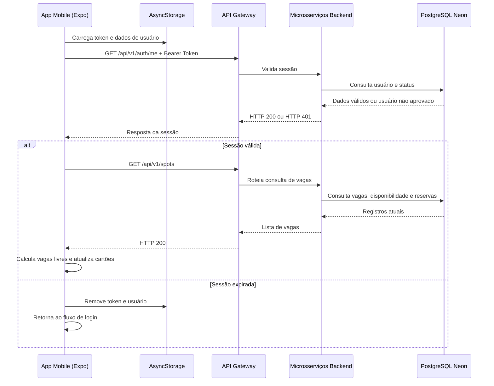

# 📱 Etapa 4: Interface Móvel Integrada (Front-end Móvel)

Este documento serve como diretriz mestre de interface e repositório de evidências para a **Etapa 4: Desenvolvimento do Front-end Móvel**. Ele foi estruturado para orientar o desenvolvimento prático do aplicativo móvel híbrido ou nativo e permitir o acompanhamento e a auto-gestão das atividades pelos alunos.

---

## 🎯 Rubricas de Avaliação desta Etapa

Ao final desta Etapa, cada aluno será avaliado individualmente nestas 6 competências (incluindo oportunidades de desenvolvimento e reavaliação):

1. **H34a-SI-G: Gerenciar e documentar serviços de TI**: Gerenciar e documentar serviços de TI, de forma clara e objetiva (Reavaliação teórica e prática a partir do gerenciamento de serviços no frontend móvel em [src/mobile/](src/mobile/)).
2. **H35b-SI-G: Planejar, desenvolver e gerenciar uma arquitetura de aplicação distribuída**: Desenvolver uma arquitetura de aplicação distribuída (Integração dinâmica do aplicativo móvel com as APIs do backend distribuído desenvolvidas na Etapa 2, medido no código em [src/mobile/](src/mobile/) e na seção [Conectividade e Integração de Dados Móveis](#3-conectividade-e-integracao-de-dados-moveis)).
3. **H35c-SI-G: Planejar, desenvolver e gerenciar uma arquitetura de aplicação distribuída**: Gerenciar uma arquitetura de aplicação distribuída, testando, implantando e avaliando a solução (Processo de modelagem de empacotamento, automação teórica de builds nativos e emulação local, medido na seção [Instruções de Implantação e DevOps Móvel](#5-instrucoes-de-implantacao-e-devops-movel)).
4. **H38a-SI-G: Planejar, desenvolver e gerenciar uma aplicação móvel**: Planejar e documentar uma aplicação móvel, de forma clara e objetiva (Reavaliação/ajustes de planejamento, diagramação e fluxos touch/gestos no mobile, medido em [docs/frontend-mobile.md](docs/frontend-mobile.md)).
5. **H38b-SI-G: Planejar, desenvolver e gerenciar uma aplicação móvel**: Desenvolver uma aplicação móvel (Construção de telas e componentes interativos e uso estruturado de sensores físicos ou recursos locais do smartphone, como Câmera, Geolocalização/GPS, Notificações Push ou Armazenamento offline-first, medido em [src/mobile/](src/mobile/) e na seção [Desenvolvimento de Telas e Sensores Móveis](#2-desenvolvimento-de-telas-e-sensores-moveis)).
6. **H38c-SI-G: Planejar, desenvolver e gerenciar uma aplicação móvel**: Gerenciar uma aplicação móvel, testando, implantando e avaliando a solução (Escrita de suítes de testes unitários móveis, testes de interface móvel ou evidências instrumentadas de emulação bem-sucedida, medido na seção [Estratégia e Relatório de Testes Móveis](#4-estrategia-e-relatorio-de-testes-moveis)).

---

## 📅 QUADRO DE CONTRIBUIÇÃO REAL (ETAPA 4)

**Atenção alunos:** Preencham esta tabela para atualizar o andamento das tarefas e quem foi o responsável técnico pela construção do Front-end Móvel. Os nomes, usuários e links de evidências devem corresponder aos entregáveis em [src/mobile/](src/mobile/).

- **Status admitidos**: `⌛ Não Iniciado` | `📝 Em Progresso` | `✔️ Entregue`
- **Autoria Git**: Indica se há commits desse estudante nos arquivos da tarefa.

**Atividades Semanais desta Etapa** (ver [Cronograma do Semestre](contexto.md#-cronograma-do-semestre-semana--periodo)):
- `ATV4.1` — Desenvolvimento de Funcionalidades - Mobile (Semanas 14 a 16)
- `ATV4.2` — Testes - Front-End Mobile (Semana 17)

| Rubrica Curricular | ID Tarefa | Atividade Semanal | Descrição Detalhada da Tarefa | Estudante Responsável | GitHub Username | Status de Entrega | Evidência/Seção Temática | Autoria Git |
| :---: | :---: | :---: | :--- | :--- | :---: | :---: | :--- | :---: |
| **H38b** | `T4.1` | `ATV4.1` | Configuração Inicial e Estrutura do App (Expo, Flutter CLI, etc.) | Pedro Henrique Correia Cassimiro | `pedroh-corr` | `✔️ Entregue` | [Instalação/README](../src/mobile/README.md) | [x] |
| **H38b** | `T4.2` | `ATV4.1` | Desenvolvimento da Navegação Nativa (Tabs, Drawer, Stack) | Pedro Henrique Correia Cassimiro | `pedroh-corr` | `✔️ Entregue` | [Seção 2.1](#21-telas-desenvolvidas-e-fluxos-de-gestos) | [x] |
| **H38b** | `T4.3` | `ATV4.1` | Implementação das Interfaces de Usuário Principais do App | Roberta Alves Lima | `RobertaAlvesLima` | `✔️ Entregue` | [Seção 2.1](#21-telas-desenvolvidas-e-fluxos-de-gestos) | [x] |
| **H38b** | `T4.4` | `ATV4.1` | Integração com Recursos Físicos (GPS, Câmera, Local Storage) | Roberta Alves Lima | `RobertaAlvesLima` | `✔️ Entregue` | [Seção 2.2](#22-integracao-de-hardware-e-recursos-nativos) | [x] |
| **H35b** | `T4.5` | `ATV4.1` | Sincronismo Remoto das Rota de APIs no Mobile (Axios, Offline-First) | Pedro Henrique Correia Cassimiro | `pedroh-corr` | `✔️ Entregue` | [Seção 3.2](#32-servico-de-integracao-de-rede) | [x] |
| **H38c** | `T4.6` | `ATV4.2` | Desenvolvimento de Testes Móveis de Componentes ou Usabilidade | Andre de Sousa Lopes | `dezim005` | `✔️ Entregue` | [Seção 4.1](#41-suite-de-testes-mobile) | [x] |
| **H35c** | `T4.7` | `ATV4.1` | Proposta de Pipeline de Build Móvel e Provisionamento | Andre de Sousa Lopes | `dezim005` | `✔️ Entregue` | [Seção 5.1](#51-proposta-de-pipeline-de-build-e-empacotamento-nativo) | [x] |
| **H38c** | `T4.8` | `ATV4.2` | Roteiro de Emulação e Instruções de Execução Local do App | Pedro Henrique Correia Cassimiro | `pedroh-corr` | `✔️ Entregue` | [Seção 5.2](#52-disponibilizacao-de-ambiente-de-teste-e-emulacao-local) | [x] |

---

# 1. Escopo e Diretrizes da Interface Móvel

O aplicativo móvel do **VagaLivre** foi desenvolvido com **React Native** sobre **Expo SDK 58**, utilizando **React Navigation** para autenticação, navegação em pilha e menu lateral. A aplicação funciona como um cliente distribuído do ecossistema do projeto: todas as operações são enviadas ao API Gateway de produção em `https://gateway-api-d2uo.onrender.com`, que roteia as chamadas para os microsserviços de identidade, usuários, condomínios, vagas, reservas e notificações.

O escopo entregue cobre login e cadastro, autenticação persistente, painel de vagas livres, cadastro e disponibilidade das vagas, reservas e cancelamentos, histórico de reservas, perfil do usuário e todas as operações administrativas destinadas ao papel `manager`. As telas foram projetadas para uso touch em smartphones, com cartões, listas roláveis, ações visíveis, modais de confirmação, campos com rótulos claros, hierarquia visual consistente e áreas de toque adequadas. A identidade visual acompanha a versão web por meio da paleta verde-água `#0CA789`, fundos claros `#F8FAFC`, superfícies brancas, verde suave `#85E085` para disponibilidade e vermelho para ações destrutivas.

---

# 2. Desenvolvimento de Telas e Sensores Móveis

*(Esta seção atende diretamente à rubrica **H38b**)*

Abaixo detalhe como as interfaces visuais e os comportamentos nativos físicos foram implementados nos diretórios de código em [src/mobile/](src/mobile/).

## 2.1. Telas Desenvolvidas e Fluxos de Gestos

As telas foram organizadas em um fluxo público de autenticação e em um fluxo autenticado protegido pelo estado global da aplicação. Após o login, o usuário acessa as funcionalidades por meio de um cabeçalho com botão lateral no canto superior esquerdo e foto/círculo com a inicial do nome no canto superior direito.

* **Página 1: Login / Autenticação Móvel**
  * **Funcionamento:** apresenta o logo Vaga Livre, um cartão central de boas-vindas e os campos de Email e Senha. O visual utiliza fundo claro, bordas, áreas de toque amplas e o verde principal da identidade do projeto.
  * **Submissão de Dados:** ao tocar em Entrar, a tela valida se os campos foram preenchidos e envia `POST /api/v1/auth/login`. Em caso de sucesso, o token e o usuário são persistidos no AsyncStorage e o aplicativo entra no fluxo autenticado. Erros de rede, servidor indisponível e credenciais inválidas são apresentados por Alert.
  * **Cadastro:** a opção Cadastre-se abre a tela de criação de conta.

* **Página 2: Cadastro de Usuário**
  * **Funcionamento:** permite informar nome, email, senha, confirmação de senha, apartamento, bloco e condomínio. Os condomínios disponíveis são carregados por `GET /api/v1/condominiums`.
  * **Submissão de Dados:** envia `POST /api/v1/users`. O cadastro comum permanece pendente até aprovação do síndico; o primeiro usuário elegível pode receber perfil de síndico conforme as regras do backend.

* **Página 3: Menu Lateral de Navegação**
  * **Funcionamento:** é aberto pelo ícone de menu no cabeçalho. Exibe o logo Vaga Livre, Painel, Minhas Vagas, Minhas Reservas, Reservar Vaga e Ver Perfil. Usuários com `role === manager` recebem ainda a seção Administração com Cadastrar Condomínio, Gerenciar Usuários, Histórico de Aluguéis e Aprovações.
  * **Gestos:** o usuário toca em uma opção para fechar o drawer e navegar pela pilha principal. O botão do avatar abre diretamente o perfil, e o botão Sair encerra a sessão.

* **Página 4: Painel de Vagas**
  * **Funcionamento:** exibe apenas vagas livres, isto é, vagas com `isAvailable !== false`, pelo menos um intervalo em `availability` e pelo menos um dia futuro sem conflito com reservas existentes.
  * **Controles:** permite busca por número ou localização e apresenta cartão com nome da vaga, localização, proprietário, descrição, status disponível e ação para abrir a reserva.

* **Página 5: Minhas Vagas**
  * **Funcionamento:** mostra as vagas próprias do morador; para síndicos, aplica a regra da versão web e apresenta todas as vagas disponíveis ao gerenciamento administrativo.
  * **Controles:** permite cadastrar vaga com número, tipo, localização e descrição por `POST /api/ParkingSpots`. Também permite definir período de disponibilidade por `PATCH /api/ParkingSpots/{id}/availability`.

* **Página 6: Reservar Vaga**
  * **Funcionamento:** apresenta o mesmo conjunto de vagas livres mostrado no painel, com busca por número/localização e filtros por tipo. Cada cartão identifica número, localização, tipo, proprietário e descrição.
  * **Reserva:** ao tocar em Ver Disponibilidade e Reservar, abre calendário com dias disponíveis em verde. O usuário seleciona somente dias livres e consecutivos. Ao confirmar, envia `spotId`, `userId`, `startTime` e `endTime`; não exige placa de veículo, pois ela é opcional no contrato atual da reserva.

* **Página 7: Minhas Reservas**
  * **Funcionamento:** lista as reservas do usuário autenticado e resolve o número real da vaga em vez de mostrar o ID técnico. Mostra período, local e placa somente quando informada.
  * **Cancelamento:** permite cancelar uma reserva própria por confirmação em Alert. O mobile envia o `userId` na exclusão por `DELETE /api/v1/reservations/{id}?userId={userId}` e atualiza a lista após o sucesso.

* **Página 8: Meu Perfil**
  * **Funcionamento:** apresenta avatar circular com a inicial do usuário, nome, email, papel e condomínio. Permite editar nome, apartamento/bloco, data de nascimento, CPF, telefone e descrição.
  * **Persistência:** salva as alterações por `PATCH /api/v1/users/{id}` e atualiza o usuário persistido no AsyncStorage. Email e condomínio são exibidos como campos não editáveis nesta tela.

* **Página 9: Cadastrar Condomínio (manager)**
  * **Funcionamento:** tela administrativa protegida por `role === manager`, com nome e endereço do condomínio.
  * **Submissão:** envia `POST /api/v1/condominiums` e informa o usuário em caso de sucesso ou falha.

* **Página 10: Aprovações (manager)**
  * **Funcionamento:** lista usuários pendentes de todos os condomínios e permite aprovar ou negar os cadastros por `PATCH /api/v1/users/{id}`.

* **Página 11: Histórico de Aluguéis (manager)**
  * **Funcionamento:** reúne todas as reservas e as relaciona aos nomes dos usuários e às vagas correspondentes.
  * **Controles:** filtra por morador e por período, limpa filtros e compartilha o relatório em formato CSV utilizando recursos nativos de compartilhamento do smartphone.

* **Página 12: Gerenciar Usuários (manager)**
  * **Funcionamento:** lista todos os usuários cadastrados, com busca por nome ou email.
  * **Ação Ver:** pode ser disparada pelo botão ou tocando no cartão, abrindo os dados completos, incluindo nome, email, status, apartamento, condomínio, papel, data de nascimento, CPF, telefone, descrição e data de cadastro.
  * **Ação Editar:** permite alterar nome, apartamento, papel, status, condomínio para residentes, data de nascimento, CPF, telefone e descrição. Email permanece somente leitura.
  * **Ação Excluir:** confirma a exclusão antes da chamada `DELETE /api/v1/users/{id}` e encerra a sessão caso o síndico exclua a própria conta.

*Insira ou anexe Screenshots funcionais do aplicativo rodando em um emulador ou aparelho real:*

As evidências visuais devem incluir login/cadastro, menu lateral, painel, minhas vagas, minhas reservas, reservar vaga, perfil, cadastro de condomínio, aprovações, histórico de aluguéis e gerenciar usuários.

## 2.2. Integração de Hardware e Recursos Nativos

O aplicativo utiliza recursos locais compatíveis com o escopo atual do projeto e com a implementação disponível no Expo:

* **Armazenamento local:** utiliza `@react-native-async-storage/async-storage` para persistir o token em `@vagalivre_token` e os dados do usuário em `@vagalivre_user`. Na inicialização, o estado restaurado é validado em segundo plano por `GET /api/v1/auth/me`; em caso de sessão inválida ou HTTP 401, os dados locais são removidos.
* **Compartilhamento nativo:** a tela Histórico de Aluguéis utiliza `Share.share` do React Native para compartilhar o relatório CSV gerado em memória, sem depender de uma biblioteca adicional.
* **Toques e gestos:** os componentes usam `TouchableOpacity`, `FlatList`, `ScrollView` e `Modal`. A navegação lateral usa um modal de drawer sobreposto, fechado pelo toque no fundo ou pela seleção de uma rota.
* **Validação visual:** o aplicativo utiliza Alertas nativos, indicadores `ActivityIndicator`, atualização por pull-to-refresh nas listas e desabilitação temporária de ações durante requisições.
* **Notificações:** o projeto não implementa Notifications Push no dispositivo nem uma central local. O envio ao usuário ocorre por e-mail após a reserva confirmada, por meio da API de notificações.
* **GPS, Câmera e código de barras:** não são utilizados nesta versão, pois o fluxo de vagas foi construído com número, localização textual e disponibilidade por datas. O projeto não solicita localização em tempo real, fotografia, QR code ou leitor de código de barras.

---

# 3. Conectividade e Integração de Dados Móveis

*(Esta seção atende diretamente à rubrica **H35b**)*

## 3.1. Arquitetura de Comunicação Síncrona / Assíncrona

## 3.2. Serviço de Integração de Rede

A integração mobile centraliza as chamadas em um cliente Axios configurado em `src/mobile/src/services/api.ts`. O cliente utiliza o gateway como URL base, com timeout de 60 segundos para tolerar o cold start dos serviços hospedados no Render.

* **Interceptador de requisição:** recupera o token de `@vagalivre_token` no AsyncStorage e envia `Authorization: Bearer <token>` em todas as chamadas.
* **Interceptador de resposta:** quando o backend responde HTTP 401, remove o token e o usuário persistidos. O contexto de autenticação valida a sessão na inicialização e retorna o usuário ao login.
* **Serviços especializados:** `spotService`, `reservationService`, `userService`, `condominiumService` e `notificationService` encapsulam os contratos usados pelas telas, reduzindo o acoplamento dos componentes aos detalhes HTTP.
* **Atualização das telas:** as telas recarregam dados após login, cadastro, confirmação de reserva, cancelamento, alteração de perfil e mudanças administrativas. Também oferecem pull-to-refresh nas listas.
* **Tratamento de falhas:** chamadas são envolvidas por mensagens de erro consistentes. A aplicação apresenta Alertas específicos para credenciais inválidas, servidor indisponível, conflito de reserva, período fora da disponibilidade e falha em operações administrativas.
* **Disponibilidade remota:** o cálculo visual considera os dados enviados pelos microsserviços, mas o app não mantém fila offline nem banco SQLite. A aplicação depende de conexão ativa para criar, alterar ou cancelar registros; os dados de sessão são os únicos persistidos localmente.

---

# 4. Estratégia e Relatório de Testes Móveis

*(Esta seção atende diretamente à rubrica **H38c**)*

A estratégia de validação móvel combina verificação estática de TypeScript, execução em emulador Expo e validação manual dos fluxos críticos. O principal risco observado foi a divergência entre os contratos do backend e o formato enviado pelo aplicativo; por isso, os dados dos formulários foram alinhados aos campos esperados pelas APIs, como `spotId`, `userId`, `startTime`, `endTime`, `availability`, `status` e `condominiumId`.

Os fluxos críticos validados abrangem autenticação e restauração da sessão, busca e filtragem de vagas, remoção visual de vagas ocupadas ou sem disponibilidade, seleção de dias consecutivos no calendário, criação e cancelamento de reservas, envio da notificação transacional, edição do perfil, cadastro de vagas e condomínio, aprovação de moradores e ações administrativas de usuários.

O projeto não contém atualmente uma suíte automatizada React Native Testing Library, Jest, Maestro ou Appium configurada no diretório mobile. A validação automatizada disponível é o comando de TypeScript, complementada por testes de usabilidade em emulação.

## 4.1. Suíte de Testes Mobile

- **Ferramenta de Teste Utilizada**: Verificação estática com `TypeScript`; execução funcional com Expo Go ou emuladores Android/iOS.
- **Comando de Execução**: `npx tsc --noEmit` no diretório `src/mobile`; `npx expo start` para execução em emulador ou dispositivo físico.

### Tabela de Cobertura de Testes Mobile:

| Tela / Módulo Móvel | Tipo de Teste (Unitário/Instumentado) | Comportamento Validado | Status da Suíte |
| :--- | :--- | :--- | :---: |
| **Tela de Login** | Manual / Instrumentado | Renderização do logo, campos, submissão e persistência da sessão | ✔️ Passou |
| **Navegação e Menu Lateral** | Manual / Instrumentado | Acesso às telas e restrição das opções administrativas por `manager` | ✔️ Passou |
| **Painel e Reservar Vaga** | Manual / Instrumentado | Ocultar vagas indisponíveis, buscar vagas e listar somente dias livres | ✔️ Passou |
| **Reserva de Vaga** | Manual / Instrumentado | Envio de `spotId`, `userId`, `startTime` e `endTime`, conflito e notificação | ✔️ Passou |
| **Minhas Reservas** | Manual / Instrumentado | Exibição do número da vaga e cancelamento com confirmação | ✔️ Passou |
| **Minhas Vagas** | Manual / Instrumentado | Cadastro da vaga e atualização da disponibilidade | ✔️ Passou |
| **Meu Perfil** | Manual / Instrumentado | Atualização dos dados editáveis e persistência no contexto | ✔️ Passou |
| **Aprovações** | Manual / Instrumentado | Aprovação e recusa de usuários pendentes | ✔️ Passou |
| **Gerenciar Usuários** | Manual / Instrumentado | Visualização detalhada, edição completa, condomínio, status e exclusão | ✔️ Passou |
| **Histórico de Aluguéis** | Manual / Instrumentado | Filtros por usuário/período e compartilhamento de relatório CSV | ✔️ Passou |
| **TypeScript** | Estático | Ausência de erros de tipos em todas as telas e serviços | ✔️ Passou |

---

# 5. Instruções de Implantação e DevOps Móvel

*(Esta seção atende diretamente à rubrica **H35c**)*

Abaixo detalhe conceitualmente como o aplicativo móvel é empacotado e disponibilizado para testes locais. **Nota:** Não há cobrança de envio do aplicativo móvel para lojas reais (App Store / Google Play); a avaliação baseia-se na proposta teórica de automação de builds e nas instruções de execução local/emulação.

## 5.1. Proposta de Pipeline de Build e Empacotamento Nativo

- Recomenda-se utilizar o **Expo Application Services (EAS Build)** para gerar artefatos de teste. O aplicativo já possui configuração Expo em `src/mobile/app.json`, incluindo orientação retrato, ícone, interface clara e imagens adaptativas para Android.
- O perfil de build pode ser configurado em `eas.json` com os canais `development`, `preview` e `production`. `development` seria usado para emulação com ferramentas de diagnóstico, `preview` para distribuição interna de arquivos `.apk` Android e instalação de testadores, e `production` para preparar versões futuras para lojas.
- Como alternativa de automação, um workflow do GitHub Actions pode executar `npm ci`, `npx tsc --noEmit`, `npx expo-doctor` e `npx eas build --platform android --profile preview`. Os APK gerados podem ser publicados como artefatos da execução ou distribuídos por canal interno.
- Antes da geração final, devem ser substituídos os identificadores temporários, revisados nomes e versões, configuradas variáveis de ambiente para ambientes diferentes e confirmadas as permissões exigidas pelas versões Android e iOS.
- **Modelo de Pipeline de Build Móvel**: Expo Application Services (EAS Build), com GitHub Actions opcional para validar tipos e iniciar builds.

---

## 5.2. Disponibilização de Ambiente de Teste e Emulação Local

- **Canal de Execução de Teste**: Expo Go, emulador Android, emulador iOS ou dispositivo físico conectado à rede.
- **Pré-requisitos:** Node.js, npm, Expo CLI via `npx`, Android Studio com AVD para Android e, em macOS, Xcode/iOS Simulator para iOS.
- **Execução local:**
  1. Clonar o repositório e acessar `src/mobile`.
  2. Executar `npm install` para instalar dependências.
  3. Confirmar que `src/mobile/src/services/api.ts` aponta para `https://gateway-api-d2uo.onrender.com` ou alterar o valor de `API_BASE_URL` para o gateway desejado.
  4. Executar `npx expo start`.
  5. Abrir no emulador Android, no Expo Go escaneando o QR Code ou no emulador iOS.
  6. Executar `npx tsc --noEmit` para validar os tipos.
  7. Utilizar `npx expo-doctor` para validar compatibilidade de dependências e configurações Expo.
- **Indicação de ambiente:** como os serviços estão hospedados no Render, a inicialização pode exigir alguns segundos no primeiro acesso após o período de inatividade. O cliente utiliza timeout de 60 segundos e apresenta mensagens de falha em erro de autenticação ou indisponibilidade.
- **Variáveis de backend:** a versão atual usa o gateway diretamente no código. Uma melhoria futura é substituir `API_BASE_URL` por variável de ambiente do Expo para separar desenvolvimento, homologação e produção.

---

# 6. Referências Acadêmicas e de Engenharia

1. **GOOGLE**. *Material Design Guidelines*. Disponível em: <https://m3.material.io/>.
2. **APPLE**. *Human Interface Guidelines*. Disponível em: <https://developer.apple.com/design/human-interface-guidelines/>.
3. **META OPEN SOURCE**. *React Native — documentação oficial*. Disponível em: <https://reactnative.dev/docs/getting-started>.
4. **EXPO**. *Expo SDK 58 — documentação oficial*. Disponível em: <https://docs.expo.dev/versions/v58.0.0/>.
5. **REACT NAVIGATION**. *Native Stack Navigator e navegação em React Native*. Disponível em: <https://reactnavigation.org/docs/native-stack-navigator/>.
6. **AXIOS**. *Axios — documentação oficial*. Disponível em: <https://axios-http.com/docs/intro>.
7. **ASYNC STORAGE**. *React Native Async Storage — documentação oficial*. Disponível em: <https://react-native-async-storage.github.io/async-storage/docs/install/>.

