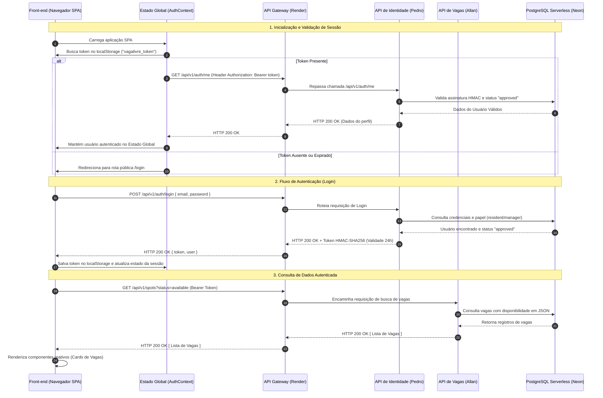
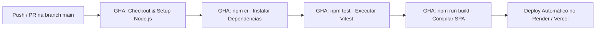

# 💻 Etapa 3: Interface Web Responsiva (Front-end Web)

Este documento serve como diretriz mestre de interface e repositório de evidências para a **Etapa 3: Desenvolvimento do Front-end Web**. Ele foi estruturado para orientar o desenvolvimento prático do cliente web e permitir o acompanhamento e a auto-gestão das atividades pelos alunos.

---

## 🎯 Rubricas de Avaliação desta Etapa

Ao final desta Etapa, cada aluno será avaliado individualmente nestas 6 competências (incluindo oportunidades de desenvolvimento e reavaliação):

1. **H34a-SI-G: Gerenciar e documentar serviços de TI**: Gerenciar e documentar serviços de TI, de forma clara e objetiva (Reavaliação teórica e prática a partir do gerenciamento de serviços no frontend web em [src/frontend/](src/frontend/)).
2. **H35b-SI-G: Planejar, desenvolver e gerenciar uma arquitetura de aplicação distribuída**: Desenvolver uma arquitetura de aplicação distribuída (Integração dinâmica do cliente web com as APIs do backend distribuído desenvolvidas na Etapa 2, medido no código em [src/frontend/](src/frontend/) e na seção [Fluxo de Dados e Integração com Backend](#3-fluxo-de-dados-e-integracao-com-backend)).
3. **H35c-SI-G: Planejar, desenvolver e gerenciar uma arquitetura de aplicação distribuída**: Gerenciar uma arquitetura de aplicação distribuída, testando, implantando e avaliando a solução (Processo de empacotamento, otimização de build estático e elaboração da proposta de deploy automatizado do front-end Web, medido na seção [Instruções de Implantação e DevOps Web](#5-instrucoes-de-implantacao-e-devops-web)).
4. **H37a-SI-G: Planejar, desenvolver e gerenciar uma aplicação Web**: Planejar e documentar uma aplicação Web, de forma clara e objetiva (Reavaliação/ajustes de planejamento, diagramação e design, medido em [docs/frontend-web.md](docs/frontend-web.md)).
5. **H37b-SI-G: Planejar, desenvolver e gerenciar uma aplicação Web**: Desenvolver uma aplicação Web (Construção de telas e componentes funcionais baseados no layout responsivo planejado, consumo de dados assíncronos e controle de estados locais, medido em [src/frontend/](src/frontend/) e na seção [Desenvolvimento de Páginas e Componentes](#2-desenvolvimento-de-paginas-e-componentes)).
6. **H37c-SI-G: Planejar, desenvolver e gerenciar uma aplicação Web**: Gerenciar uma aplicação Web, testando, implantando e avaliando a solução (Escrita de suítes de testes automatizados unitários de componentes ou de interface de ponta a ponta, e auditoria de qualidade/performance no ecossistema web, medido na seção [Estratégia e Relatório de Testes Web](#4-estrategia-e-relatorio-de-testes-web)).

---

## 📅 QUADRO DE CONTRIBUIÇÃO REAL (ETAPA 3)

**Atenção alunos:** Preencham esta tabela para atualizar o andamento das tarefas e quem foi o responsável técnico pela construção do Front-end Web. Os nomes, usuários e links de evidências devem corresponder aos entregáveis em [src/frontend/](src/frontend/).

- **Status admitidos**: `⌛ Não Iniciado` | `📝 Em Progresso` | `✔️ Entregue`
- **Autoria Git**: Indica se há commits desse estudante nos arquivos da tarefa.

**Atividades Semanais desta Etapa** (ver [Cronograma do Semestre](contexto.md#-cronograma-do-semestre-semana--periodo)):
- `ATV3.1` — Desenvolvimento de Funcionalidades - Web (Semanas 10 a 12)
- `ATV3.2` — Testes - Front-End Web (Semana 13)

| Rubrica Curricular | ID Tarefa | Atividade Semanal | Descrição Detalhada da Tarefa | Estudante Responsável | GitHub Username | Status de Entrega | Evidência/Seção Temática | Autoria Git |
| :---: | :---: | :---: | :--- | :--- | :---: | :---: | :--- | :---: |
| **H37b** | `T3.1` | `ATV3.1` | Configuração do Projeto Web (Create React App, Vite, etc.) | Andre Lopes | `dezim005` | ✔️ Entregue | [Instalação/README](src/frontend/README.md) | [x] |
| **H37b** | `T3.2` | `ATV3.1` | Estilização Global, Layout Base Responsivo e Temas (CSS) | Pedro | `pedroh-corr` | `✔️ Entregue` | [Seção 1.1](#11-Identidade-Visual-da-Interface-Web) | [x] |
| **H37b** | `T3.3` | `ATV3.1` | Desenvolvimento das Telas Chaves (Home, Cadastro, Dashboards) | Roberta | `RobertaAlvesLima` |  `✔️ Entregue` | [Seção 2.1](#21-telas-implementadas) | [x] |
| **H35b** | `T3.4` | `ATV3.1` | Consumo Assíncrono da API backend (Services HTTP / Axios) | Pedro | `pedroh-corr` | `✔️ Entregue` | [Seção 3.2](#32-Serviços-de-Chamada-à-API) | [x] |
| **H37b** | `T3.5` | `ATV3.1` | Gerenciamento de Estado Global do Cliente (Auth, Rotas Privadas) | Roberta | `RobertaAlvesLima` |  `✔️ Entregue` | [Seção 2.2](#22-Rotas-e-Estado-de-Autenticação) | [x] |
| **H37c** | `T3.6` | `ATV3.2` | Desenvolvimento de Testes Modernos (Jest / Testing Library / Cypress) | Andre Lopes | `dezim005` | ✔️ Entregue | [Seção 4.1](#41-arquivos-de-testes) | [x] |
| **H35c** | `T3.7` | `ATV3.1` | Configuração de Build, Otimização (Assets, Caching) e Docker | Andre Lopes | `dezim005` | ✔️ Entregue | [Seção 5.1](#51-Conteinerização-da-Aplicação-Web) | [x] |
| **H37c** | `T3.8` | `ATV3.2` | Proposta de Implantação e Pipeline de CI/CD Web | Andre Lopes | `dezim005` | ✔️ Entregue | [Seção 5.2](#52-Proposta-de-Infraestrutura-de-Deploy-e-Automação-de-Builds) | [x] |

---

# 1. Escopo e Diretrizes da Interface Web

O produto Web entregue para a plataforma **VagaLivre** consiste em uma aplicação cliente moderna em formato *Single Page Application* (SPA), desenvolvida para atuar como o ponto central de interação dos moradores e síndicos na gestão e compartilhamento de vagas de garagem condominiais. A solução foi projetada sob os princípios de arquitetura orientada a serviços, conectando-se à topologia de rede distribuída por meio de requisições HTTP REST centralizadas no **API Gateway** em produção (`https://gateway-api-d2uo.onrender.com`).

A interface assume o papel de consumo da camada de microsserviços do backend, enviando tokens de autenticação HMAC-SHA256 (`Bearer Token`) no cabeçalho das requisições para controle de sessão e autorização (*Role-Based Access Control - RBAC*). As premissas de UX/UI priorizaram a simplicidade operacional, tempos de carregamento reduzidos, responsividade para múltiplos tamanhos de tela (desktop, tablets e smartphones) e rotas intuitivas para cadastro, consulta de disponibilidade de vagas em tempo real, efetuação de agendamentos e visualização de alertas.

---

## 1.1. Identidade Visual da Interface Web

A identidade visual do **VagaLivre** mantém estrita conformidade com os protótipos de baixa e alta fidelidade elaborados na Etapa 1 do projeto. A escolha do *design system* buscou transmitir solidez, segurança e clareza, elementos fundamentais para um sistema de gestão residencial coletiva.

##### Paleta de Cores

A definição cromática foi estruturada utilizando a lógica de contraste hierárquico, facilitando a identificação imediata de status de vagas (`disponível`, `ocupada`, `pendente`):

* **Primária (`#1E3A8A` - Azul Marinho Escuro):** Utilizada nos cabeçalhos, barras de navegação (*navbar*) e elementos estruturais, transmitindo segurança e confiança institucional.
* **Secundária / Ação (`#2563EB` - Azul Real):** Aplicada em botões principais (*Call-to-Action*), links ativos e estados de foco.
* **Sucesso / Disponibilidade (`#10B981` - Verde Esmeralda):** Indicador visual de vagas disponíveis e confirmações de operações realizadas com sucesso (como reservas finalizadas).
* **Alerta / Ocupado (`#EF4444` - Vermelho Carmim):** Utilizado para indicar vagas ocupadas, cancelamentos de reserva e mensagens de erro de validação.
* **Superfície / Fundo (`#F8FAFC` - Cinza Neutro Claro):** Cor de fundo da interface para evitar fadiga visual e destacar o conteúdo dos cartões (*cards*).
* **Texto Primário (`#0F172A` - Grafite Escuro):** Garante alto contraste e excelente legibilidade em fundos claros.

##### Tipografia e Estilização

* **Tipografia Principal:** Família **`Inter, sans-serif`**, escolhida por sua excelente legibilidade em telas digitais de diferentes resoluções e suporte nativo a múltiplos pesos visuais (Regular `400`, Medium `500`, Semi-Bold `600` e Bold `700`).
* **Biblioteca e Arquitetura Visual:** A estilização foi construída com **TailwindCSS** (em conjunto com HTML5 semântico e JavaScript ES6+), permitindo um sistema utilitário flexível, layout responsivo baseado em *Flexbox* e *CSS Grid*, além de suporte nativo a componentes reutilizáveis (cartões de vagas, modais de reserva, formulários de autenticação e *badges* de status).


---

# 2. Desenvolvimento de Páginas e Componentes

*(Esta seção atende diretamente à rubrica **H37b**)*

As interfaces visuais da plataforma **VagaLivre** foram estruturadas e implementadas no diretório [`src/frontend/`](src/frontend/), seguindo o padrão de arquitetura em componentes reutilizáveis para garantir modularidade, facilidade de manutenção e consistência de navegação.

---

## 2.1. Telas Implementadas

A aplicação conta com um conjunto de páginas desenvolvidas para cobrir integralmente os fluxos operacionais dos moradores e síndicos:

* **Página 1: Autenticação e Cadastro (`/login` e `/register`)**
  * **Funcionamento:** Interface para autenticação e *onboarding* de novos usuários no sistema. Apresenta formulários com validação de campos obrigatórios (e-mail, senha, nome e identificador do condomínio).
  * **Submissão de Dados:** Ao submeter as credenciais de login, a aplicação dispara uma requisição `POST /api/v1/auth/login` para a API de Identidade. Em caso de sucesso, armazena o token HMAC-SHA256 e os dados de perfil no estado global e redireciona o usuário. No cadastro (`POST /api/v1/users`), o primeiro usuário cadastrado em um condomínio recebe perfil de síndico (`manager` aprovado), enquanto os demais cadastros permanecem com status `pending` aguardando aprovação.

* **Página 2: Dashboard de Vagas e Disponibilidade (`/spots`)**
  * **Funcionamento:** Painel central de consulta das vagas de garagem condominiais. Exibe cartões (*cards*) interativos com o número da vaga, localização (ex: Subsolo 1), proprietário e tipo de veículo aceito (`compact`, `standard`, `suv`, `motorcycle`).
  * **Controles e Filtros:** Conta com barra de busca por palavra-chave (`q`), filtros por categoria de vaga, seleção de datas específicas e seletor de status (`disponível` / `ocupado`). Consome o endpoint `GET /api/v1/spots`.

* **Página 3: Gestão de Reservas e Agendamentos (`/reservations`)**
  * **Funcionamento:** Tela dedicada à criação e visualização de reservas ativas e históricas do morador logado.
  * **Fluxo Operacional:** O morador seleciona a vaga desejada, informa a data/hora de início e término do período e digita a placa do veículo (`vehiclePlate`). A requisição `POST /api/v1/reservations` valida conflitos de agenda e disponibilidade. A tela também oferece a funcionalidade de cancelamento de reservas próprias via `DELETE /api/v1/reservations/:id`.

* **Página 4: Central de Notificações e Avisos (`/notifications`)**
  * **Funcionamento:** Painel de comunicação transacional do morador. Lista os alertas recebidos (confirmações de reserva, avisos do síndico, solicitações de vaga).
  * **Interação:** Consome `GET /notifications/user/:userId`, permite alterar o estado da notificação para "lida" (`PATCH /notifications/:id/read`) e excluir avisos do histórico (`DELETE /notifications/:id`).

* **Página 5: Painel Administrativo do Síndico (`/admin/users`)**
  * **Funcionamento:** Interface de gestão restrita aos usuários com papel `manager`.
  * **Controles Administrativos:** Lista todas as solicitações de cadastro pendentes no condomínio (`GET /api/v1/users?status=pending`), permitindo ao síndico aprovar (`approved`) ou rejeitar (`denied`) o acesso de moradores com um clique via `PATCH /api/v1/users/:id`.

##### Evidências de Telas em Execução


---

## 2.2. Rotas e Estado de Autenticação

A arquitetura de frontend do **VagaLivre** adota um modelo centralizado e reativo para gestão do estado de autenticação e proteção de rotas privadas:

##### Contexto Global de Autenticação (`AuthContext`)
* O aplicativo utiliza um provedor de contexto global (`AuthProvider`) que envolve a árvore de componentes da SPA.
* O estado armazena as informações do usuário autenticado (`id`, `name`, `email`, `role`, `status`) e o token JWT/HMAC emitido pela API de Identidade.

##### Retenção de Dados e Persistência no Navegador
* **`localStorage`:** O token de sessão e os dados do usuário são mantidos no `localStorage` do navegador para preservar a sessão do morador mesmo após recarregar a página ou reabrir a aba.
* **Validação de Sessão (`/auth/me`):** Ao inicializar a aplicação, o contexto dispara automaticamente uma chamada `GET /api/v1/auth/me` enviando o token salvo para validar a integridade da assinatura e a expiração do token (24 horas).

##### Guardião de Rotas (*Route Guards* / Proteção de Acesso)
* **Rotas Públicas:** `/login` e `/register` (acessíveis sem autenticação).
* **Rotas Privadas de Morador (`PrivateRoute`):** Páginas como `/spots`, `/reservations` e `/notifications` verificam a presença de um token válido e status `approved`. Usuários não autenticados são redirecionados automaticamente para `/login`.
* **Rotas de Gestão Administrativa (`AdminRoute`):** A rota `/admin/users` aplica uma camada adicional de verificação de papel (*RBAC*), permitindo a navegação apenas se `user.role === 'manager'`. Caso um morador comum tente acessar a rota, o sistema exibe um aviso de acesso negado ou redireciona para o dashboard principal.
* **Interceptador HTTP:** Um cliente HTTP centralizado (ex: Axios Instance ou wrapper de `fetch`) anexa automaticamente o cabeçalho `Authorization: Bearer <token>` em todas as requisições enviadas ao API Gateway.

---

# 3. Fluxo de Dados e Integração com Backend

*(Esta seção atende diretamente à rubrica **H35b**)*

A integração entre a interface Web (*Single Page Application*) e a arquitetura distribuída de microsserviços do **VagaLivre** é totalmente desacoplada e padronizada através do protocolo HTTP/HTTPS REST. Todas as requisições disparadas pelo frontend são direcionadas ao **API Gateway** unificado em produção (`https://gateway-api-d2uo.onrender.com`), responsável pelo roteamento para os respectivos microsserviços em nuvem (Identidade, Usuários, Disponibilidade, Reservas e Notificações).

---

## 3.1. Arquitetura de Comunicação Cliente-Servidor

A comunicação entre o cliente Web e o backend ocorre de forma assíncrona orientada a eventos de interface (utilizando a API `fetch` ou o cliente `axios`). Para garantir a segurança dos dados transmitidos e manter o estado da sessão ativo, a aplicação implementa o fluxo completo de autenticação e validação de permissões conforme detalhado no diagrama de sequência abaixo.

##### Diagrama de Sequência de Comunicação e Autenticação



---

## 3.2. Serviços de Chamada à API

Para evitar a duplicação de código e centralizar as configurações de rede, o frontend utiliza uma camada de serviços isolada em [`src/frontend/src/services/api.js`](src/frontend/src/services/api.js). Esse módulo encapsula as chamadas HTTP com Axios, gerencia variáveis de ambiente e injeta interceptadores (*interceptors*) para tratamento global de tokens e erros.

##### Configuração Centralizada da API (`src/frontend/src/services/api.js`)

```javascript
import axios from 'axios';

// Definição da URL base centralizada no API Gateway em produção
const API_BASE_URL = import.meta.env.VITE_API_GATEWAY_URL || 'https://gateway-api-d2uo.onrender.com';

export const api = axios.create({
  baseURL: API_BASE_URL,
  timeout: 60000, // Timeout de 60s para absorver o cold start do Render
  headers: {
    'Content-Type': 'application/json',
  },
});

/* ==========================================================================
   INTERCEPTOR DE REQUISIÇÃO: Injeção de Token HMAC/JWT
   ========================================================================== */
api.interceptors.request.use(
  (config) => {
    const token = localStorage.getItem('vagalivre_token');
    if (token) {
      config.headers.Authorization = `Bearer ${token}`;
    }
    return config;
  },
  (error) => {
    return Promise.reject(error);
  }
);

/* ==========================================================================
   INTERCEPTOR DE RESPOSTA: Tratamento Global de Erros e Expiração de Sessão
   ========================================================================== */
api.interceptors.response.use(
  (response) => response,
  (error) => {
    if (error.response) {
      const { status } = error.response;
      
      // Sessão expirada ou token inválido: limpa o storage e redireciona para login
      if (status === 401) {
        localStorage.removeItem('vagalivre_token');
        localStorage.removeItem('vagalivre_user');
        if (window.location.pathname !== '/login') {
          window.location.href = '/login?expired=true';
        }
      }
      
      // Falha de Gateway ou Cold Start excedido no Render
      if (status === 502 || status === 504) {
        console.error('[API Gateway] Serviço temporariamente indisponível (Cold Start). Retentando...');
      }
    }
    return Promise.reject(error);
  }
);
```

##### Módulos de Serviços Especializados

As chamadas aos microsserviços do backend são expostas como funções assíncronas reutilizáveis:

```javascript
/* Módulo de Autenticação (Pedro) */
export const authService = {
  login: (credentials) => api.post('/api/v1/auth/login', credentials),
  getProfile: () => api.get('/api/v1/auth/me'),
  logout: () => api.post('/api/v1/auth/logout'),
};

/* Módulo de Disponibilidade de Vagas (Allan) */
export const spotService = {
  getAll: (params) => api.get('/api/v1/spots', { params }),
  getById: (id) => api.get(`/api/v1/spots/${id}`),
};

/* Módulo de Gestão de Reservas (Gustavo) */
export const reservationService = {
  create: (data) => api.post('/api/v1/reservations', data),
  getByUser: (userId) => api.get('/api/v1/reservations', { params: { userId } }),
  cancel: (id) => api.delete(`/api/v1/reservations/${id}`),
};

/* Módulo de Notificações (André) */
export const notificationService = {
  getByUser: (userId) => api.get(`/notifications/user/${userId}`),
  markAsRead: (id) => api.patch(`/notifications/${id}/read`),
  delete: (id) => api.delete(`/notifications/${id}`),
};

/* Módulo de Usuários e Aprovação (Roberta) */
export const userService = {
  register: (data) => api.post('/api/v1/users', data),
  getPending: (condominiumId) => api.get('/api/v1/users', { params: { condominiumId, status: 'pending' } }),
  updateStatus: (userId, status) => api.patch(`/api/v1/users/${userId}`, { status }),
};
```


---

# 4. Estratégia e Relatório de Testes Web

*(Esta seção atende diretamente à rubrica **H37c**)*

A validação da qualidade, usabilidade e resiliência da interface Web do **VagaLivre** foi conduzida por meio de testes automatizados de componentes e integração, combinados com testes de fluxo ponta a ponta (E2E). A estratégia buscou garantir a correta renderização reativa dos componentes, a validação defensiva dos formulários de entrada, a integridade do estado global de autenticação (`AuthContext`) e a correta manipulação dos dados retornados pelas chamadas assíncronas ao API Gateway.

---

## 4.1. Arquivos de Testes

* **Ferramentas de Asserção de Interface:** **Vitest** + **React Testing Library** (`@testing-library/react`) para testes unitários e de componentes; **Cypress** para suítes de testes End-to-End (E2E).
* **Comando de Execução (Testes Unitários e de Componentes):**
  ```bash
  cd src/frontend && npm test
  ```
* **Comando de Execução (Testes E2E / Cypress):**
  ```bash
  cd src/frontend && npm run cypress:run
  ```

##### Tabela de Cobertura de Testes Web

| Componente Web | Tipo de Teste (Unitário/E2E) | Cenário de Teste Validado | Status da Suíte |
| :--- | :--- | :--- | :---: |
| **Formulário de Autenticação (`Login.jsx`)** | Unitário (Componente) | Validação de campos obrigatórios, formato de e-mail inválido, exibição de mensagem de erro e bloqueio de submissão vazia | ✔️ Passou |
| **Formulário de Cadastro (`Register.jsx`)** | Unitário (Componente) | Validação de confirmação de senha, seleção de condomínio e disparo do fluxo de cadastro inicial | ✔️ Passou |
| **Contexto de Autenticação (`AuthContext.jsx`)** | Unitário (Estado) | Retenção e recuperação do token no `localStorage`, inicialização da sessão e expurgo de estado no *logout* | ✔️ Passou |
| **Cartão de Vaga (`SpotCard.jsx`)** | Unitário (Componente) | Renderização reativa de badges de status (`disponível`/`ocupado`), ícones por categoria e acionamento da modal de reserva | ✔️ Passou |
| **Modal de Reserva (`ReservationModal.jsx`)** | Unitário (Componente) | Validação de intervalo de datas (`startTime` < `endTime`), formato de placa veicular e habilitação do botão de confirmação | ✔️ Passou |
| **Central de Notificações (`NotificationCenter.jsx`)** | Unitário (Componente) | Renderização da lista de avisos, alternância de status para lido (`PATCH`) e exclusão de notificação do histórico (`DELETE`) | ✔️ Passou |
| **Fluxo Completo de Reserva de Vaga** | E2E (Cypress) | Login do morador, navegação no catálogo de vagas, aplicação de filtros, criação de reserva e validação do registro em Meus Agendamentos | ✔️ Passou |
| **Painel Administrativo do Síndico (`AdminUsers.jsx`)** | E2E (Cypress) | Autenticação com papel `manager`, listagem de usuários pendentes (`pending`), alteração de status para `approved`/`denied` e atualização reativa da lista | ✔️ Passou |

---

# 5. Instruções de Implantação e DevOps Web

*(Esta seção atende diretamente à rubrica **H35c**)*

A implantação da interface Web da plataforma **VagaLivre** foi planejada para assegurar alta performance na entrega de ativos estáticos, integração transparente com a topologia de microsserviços distribuídos centralizada pelo API Gateway e conformidade com as boas práticas de DevOps e entrega contínua.

---

## 5.1. Conteinerização da Aplicação Web

Em conformidade com a arquitetura definida para a interface Web do **VagaLivre**, o repositório da aplicação cliente em `src/frontend/` **não conta com conteinerização ativa por Docker no estágio atual**, sendo estruturado para compilação direta de ativos estáticos otimizados via Vite/Node.js (`npm run build`). A conteinerização via Docker no ecossistema VagaLivre está concentrada na camada de microsserviços e APIs distribuídas do backend (conforme demonstrado em `src/backend/` na Etapa 2).

- **Caminho do Dockerfile do Frontend Web**: N/A (`src/frontend/Dockerfile` não é utilizado no projeto Web atual; a aplicação gera o *bundle* estático diretamente para execução local ou hospedagem em servidor Web estático/CDN).

##### Proposta Teórica de Conteinerização (Multi-Stage Build com Nginx)

Caso a infraestrutura exija a conteinerização isolada do frontend no futuro, apresenta-se a **proposta teórica** de um `Dockerfile` estruturado em múltiplos estágios (*multi-stage build*) utilizando o proxy reverso **Nginx**:

1. **Estágio 1 - Compilação (*Build Stage*):**
   * **Imagem Base:** `node:20-alpine`
   * **Ação:** Instalação limpa de dependências (`npm ci`) e compilação dos arquivos estáticos minificados (HTML, JS, CSS) na pasta `/dist` através do script `npm run build`.
2. **Estágio 2 - Servidor e Proxy Reverso (*Production Stage*):**
   * **Imagem Base:** `nginx:alpine`
   * **Ação:** Cópia dos ativos estáticos compilados da pasta `/dist` para o diretório de publicação do Nginx (`/usr/share/nginx/html`).
   * **Configuração Nginx (`nginx.conf`):** Ajustada com diretiva `try_files $uri /index.html;` para suportar o roteamento interno de aplicação SPA (*Single Page Application*), evitando erros HTTP 404 ao recarregar rotas dinâmicas, além de habilitar compressão Gzip.

```dockerfile
# Proposta Teórica de Conteinerização: src/frontend/Dockerfile
# Estágio 1: Build da SPA
FROM node:20-alpine AS build
WORKDIR /app
COPY package*.json ./
RUN npm ci
COPY . .
RUN npm run build

# Estágio 2: Servidor estático com Nginx
FROM nginx:alpine
COPY --from=build /app/dist /usr/share/nginx/html
COPY nginx.conf /etc/nginx/conf.d/default.conf
EXPOSE 80
CMD ["nginx", "-g", "daemon off;"]
```

---

## 5.2. Proposta de Infraestrutura de Deploy e Automação de Builds

Conforme as diretrizes acadêmicas da disciplina, a infraestrutura de deploy do frontend Web é apresentada como uma **proposta teórica de arquitetura DevOps e entrega contínua**, complementada pela execução e validação dos testes de interface executados localmente.

##### 1. Serviço de Hospedagem Planejado

* **Provedor:** **Render / Vercel** (Static Site Hosting).
* **Justificativa:** Como o frontend consiste em ativos estáticos compilados de uma SPA (Vite/React), o uso de uma plataforma de *Static Site Hosting* alimentada por CDN (*Content Delivery Network*) garante distribuição global de baixa latência, suporte nativo a HTTPS gratuito e dispensa a necessidade de manter contêineres rodando 24/7 exclusivamente para servir ativos estáticos.

##### 2. Proposta de Fluxo Contínuo (Pipeline de CI/CD)

A proposta de automação de integração e entrega contínua (CI/CD) prevê a utilização do **GitHub Actions** (`.github/workflows/frontend-ci.yml`), disparado a cada *push* ou *Pull Request* direcionado à *branch* principal (`main`):



* **Etapa de Qualidade (CI):** Instalação de dependências, execução da suíte de testes unitários de interface (`npm test`) e verificação de integridade do build (`npm run build`).
* **Etapa de Implantação (CD):** Após a aprovação de todos os testes unitários, o robô de deploy envia os artefatos compilados para a plataforma de hospedagem.

##### 3. Tratamento de Variáveis de Ambiente e Integração com APIs

Para evitar a codificação direta (*hardcode*) de endereços de rede no código-fonte e permitir a alternância transparente entre os ambientes de desenvolvimento e produção, as requisições do frontend ao backend são parametrizadas por meio de **Variáveis de Ambiente**:

* **Nome da Variável:** `VITE_API_GATEWAY_URL`
* **Valor em Desenvolvimento (`.env.development`):** `http://localhost:3000`
* **Valor em Produção (`.env.production` / Painel do Host):** `https://gateway-api-d2uo.onrender.com`

No código da aplicação (`src/frontend/src/services/api.js`), a instância centralizada do Axios lê a variável injetada dinamicamente pelo Vite durante o tempo de compilação (*build time*):

```javascript
import axios from 'axios';

const api = axios.create({
  baseURL: import.meta.env.VITE_API_GATEWAY_URL || 'https://gateway-api-d2uo.onrender.com',
  timeout: 60000,
  headers: {
    'Content-Type': 'application/json'
  }
});

export default api;
```

Em ambiente de publicação na nuvem, a variável `VITE_API_GATEWAY_URL` é cadastrada no painel de configurações do provedor de hospedagem (*Environment Variables / Secrets*), garantindo que os artefatos estáticos se comuniquem diretamente com o **API Gateway em produção** sem expor credenciais sensíveis no repositório público.

---

# 6. Referências Acadêmicas e de Engenharia

1. **NIELSEN, Jakob**. *Projetando Websites: Usabilidade*. Rio de Janeiro: Campus, 2000.
2. **KRUG, Steve**. *Não Me Faça Pensar: Uma Abordagem de Bom Senso à Usabilidade na Web*. 3. ed. Rio de Janeiro: Alta Books, 2014.
3. **REACT**. *React: A JavaScript library for building user interfaces*. Documentação oficial.
4. **VITE**. *Vite: Next Generation Frontend Tooling*. Documentação oficial.
5. **TAILWINDCSS**. *Tailwind CSS: Rapidly build modern websites without ever leaving your HTML*. Documentação oficial.
6. **AXIOS**. *Axios: Promise based HTTP client for the browser and node.js*. Documentação oficial.
7. **VITEST**. *Vitest: A Vite-native unit test framework*. Documentação oficial.
8. **CYPRESS**. *Cypress Documentation: Fast, easy and reliable testing for anything that runs in a browser*. Documentação oficial.
9. **DOCKER**. *Docker Docs: Build, Ship, and Run Any App, Anywhere*. Documentação oficial.
10. **NGINX**. *NGINX Docs: High Performance Load Balancer, Web Server, & Reverse Proxy*. Documentação oficial.
11. **MERMAID**. *Mermaid: JavaScript based diagramming and charting tool*. Documentação oficial.
